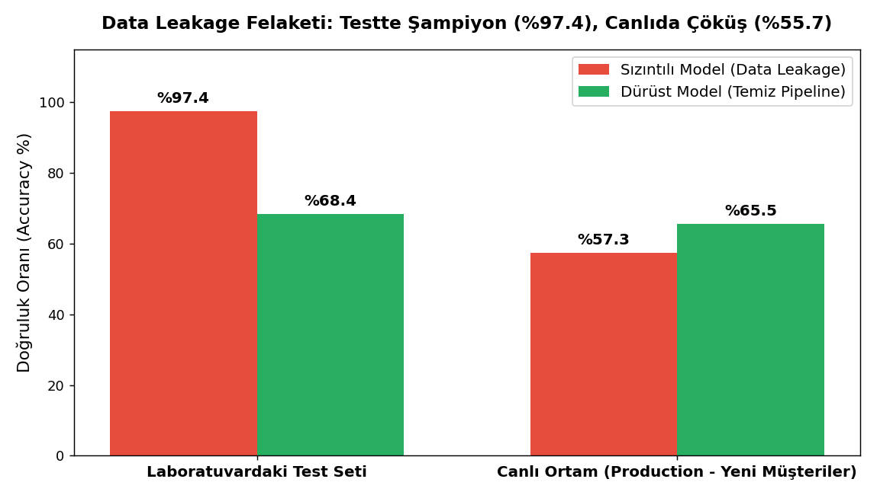
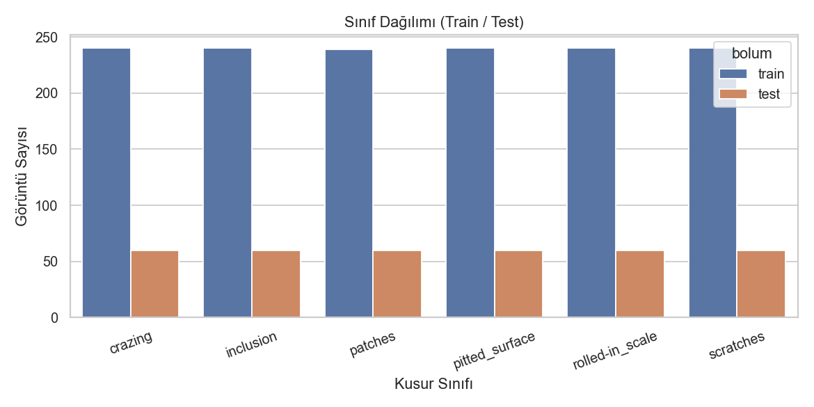
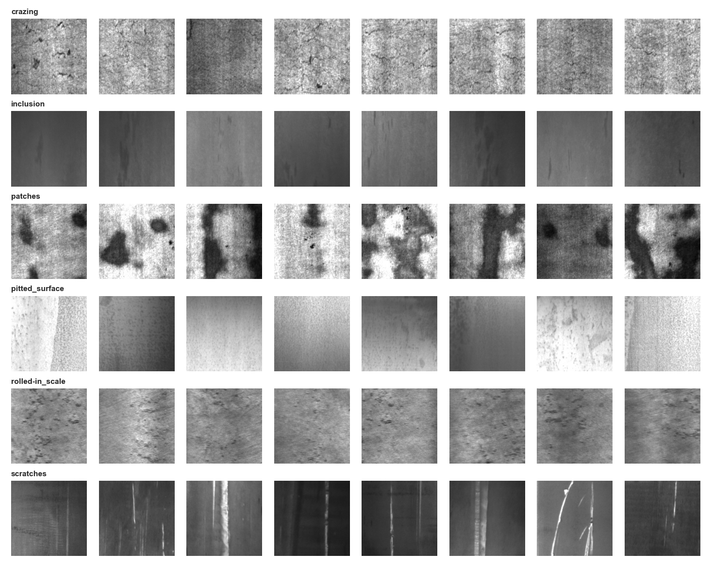
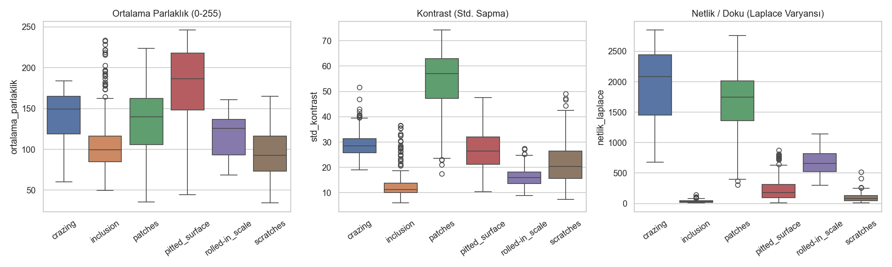
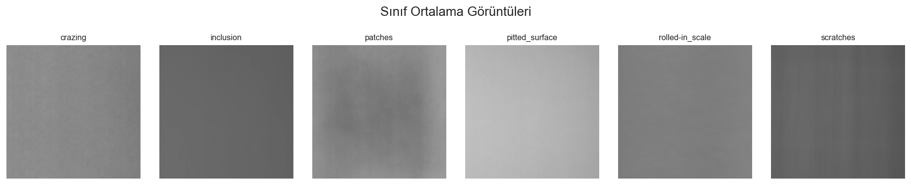
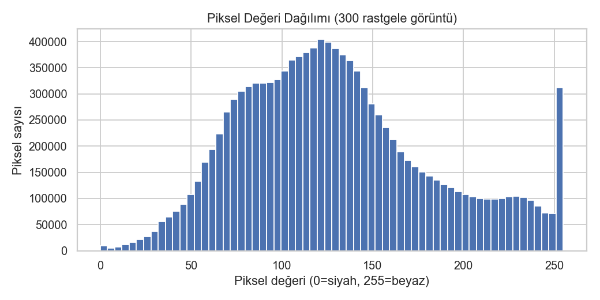
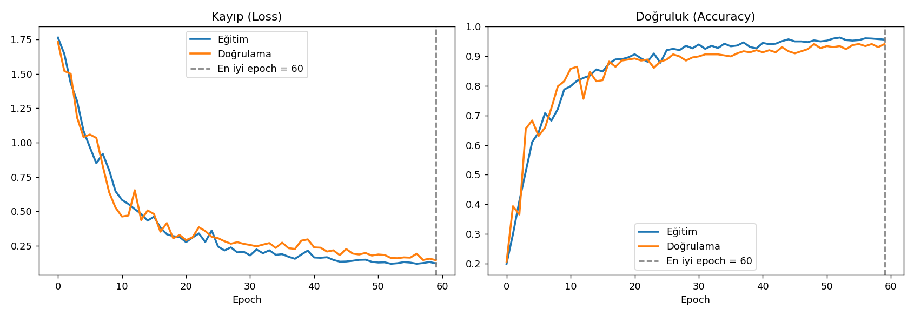
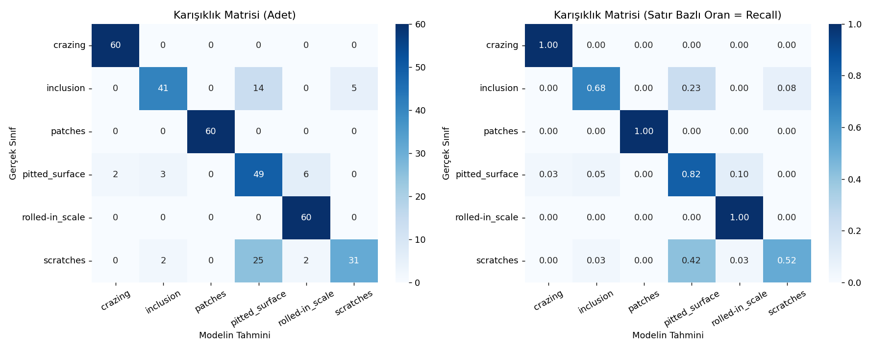
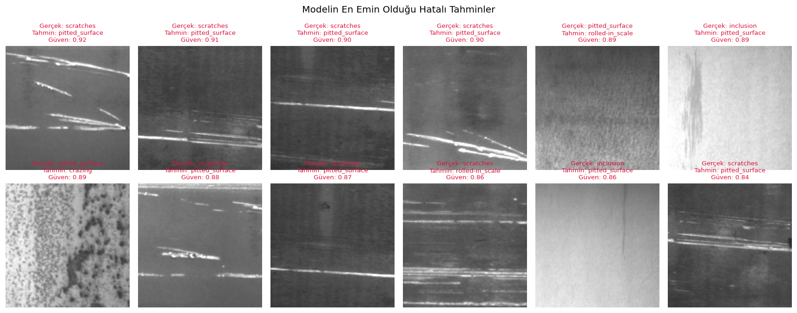
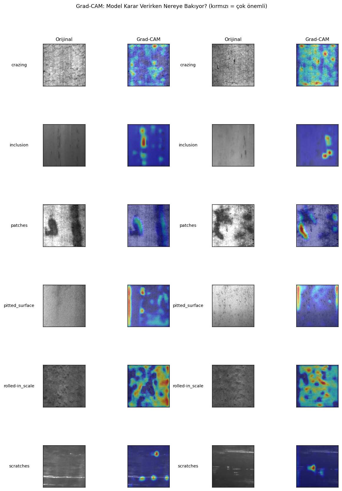

# Endüstriyel Çelik Yüzey Kusuru Tespiti (End-to-End Keras 3 & CNN)

Bu repo, sıcak haddelenmiş çelik şerit yüzeylerindeki 6 tipik kusuru (**NEU Surface Defect Database**) otomatik olarak tespit etmek için sıfırdan inşa edilmiş, endüstri standardında bir derin öğrenme projesidir.

Proje; veri hijyeni, **veri sızıntısı (data leakage)** denetimi, keşifçi veri analizi (EDA), klasik makine öğrenmesi baz çizgisi (benchmark), **Early Stopping krizinin kök neden analizi** ve **VGG tarzı kararlı CNN mimarisine geçiş** ile **Grad-CAM (açıklanabilir yapay zekâ)** adımlarını eksiksiz içerir.

---

## 📌 Proje Özeti ve Başarı Metrikleri

* **Veri Seti:** NEU-CLS (Northeastern University Surface Defect Database)
* **Kusur Sınıfları (6 Adet):** `crazing` (ince çatlak ağı), `inclusion` (yabancı madde), `patches` (büyük lekeler), `pitted_surface` (çukurcuklar), `rolled-in_scale` (hadde ezilmesi/oksit), `scratches` (çizikler)
* **Eğitim / Doğrulama Başarısı:** **%95.57 Train Acc** / **%94.08 Val Acc** (Val Loss: 0.1467)
* **Görünmeyen Test Seti Doğruluğu (360 Görüntü):** **%83.61** (Macro F1: 0.834)
* **Kusursuz Sınıflar:** `patches` (%100 F1), `crazing` (%98.4 F1), `rolled-in_scale` (%93.8 F1)

---

## 🏗️ Proje Mimarisi

```text
├── config.py                 # Tek Gerçek Kaynağı (Tüm hiperparametreler ve yollar)
├── data/
│   ├── raw/                  # Ham veri (Hugging Face / NEU Parquet)
│   └── processed/            # 1 kanallı gri tonlamalı PNG'ler (train/test) ve metadata.csv
├── docs/                     # Ayrıntılı teknik dokümantasyon
│   ├── 01_veri_edinme_ve_temizlik.md
│   ├── 02_eda.md
│   ├── 03_model_ve_egitim.md
│   └── 04_degerlendirme.md
├── models/
│   ├── neu_cnn_baseline.keras # Eğitilmiş nihai model dosyası (1.13 MB)
│   └── class_names.json       # Sınıf indeksi -> isim haritası
├── reports/
│   ├── figures/               # Tüm görsel analizler ve sonuç grafikleri
│   ├── egitim_gecmisi.csv     # 60 epoch'luk eğitim seyri
│   └── test_metrikleri.json   # Sınıf bazlı test metrikleri
└── src/
    ├── config.py
    ├── 01_veri_hazirla.py     # Veri alımı, MD5 sızıntı kontrolü, PNG dönüşümü
    ├── 02_eda.py              # Keşifçi veri analizi ve Random Forest benchmark
    ├── 03_model_egit.py       # tf.data hattı, Keras Functional CNN, Callbacks
    └── 04_degerlendir.py      # Test seti testi, hata analizi ve Grad-CAM
```

---

## 1. Veri Kalitesi ve Veri Sızıntısını (Data Leakage) Nasıl Engelledik?

### A) Görsel Veride MD5 Parmak İzi ile Sızıntı Tespiti
Görsel veri setlerinde dosya adlarına (`train_01.png`, `test_99.png`) güvenmek büyük bir tuzaktır. İnternetten veya fabrikadan toplanan verilerde aynı görsel farklı adlarla hem eğitim hem test klasörüne düşmüş olabilir. Bu durumda model testteki görselin piksellerini önceden ezberler (**Data Leakage**) ve sahte bir başarı gösterir.

Bunu engellemek için [`src/01_veri_hazirla.py`](src/01_veri_hazirla.py) içinde tüm görüntülerin piksel baytlarından **32 karakterlik MD5 özeti (dijital parmak izi)** hesapladık:

```python
# Piksellerin değişmez kriptografik özeti
parmak_izi = hashlib.md5(rgb_goruntu.tobytes()).hexdigest()
```

* **Train ↔ Test Kesişimi:** `train_hashleri.intersection(test_hashleri)` kontrol edildi: **0 ortak görsel** (%100 temiz, sıfır sızıntı).
* **Train İçi Kopya:** `patches` sınıfında aynı fotoğrafın iki kez bulunduğu tespit edildi ve 1 tanesi elendi (Train seti 1.439 örneğe indirildi).

---

### B) CSV / Tablo Verisi Olsaydı Ne Olurdu? (Canlı Simülasyonumuz)
CSV verilerinde veri sızıntısı; hedef değiştikten sonra oluşan sütunların modele verilmesi (**Target Leakage**) veya ölçeklendiricinin (`StandardScaler`) veriyi bölmeden önce tüm tabloya uygulanmasıyla (**Preprocessing Leakage**) oluşur.

Bunu kanıtlamak için 5.000 müşterilik bir kredi batma simülasyonu çalıştırdık. Kredi battıktan sonra açılan `yasal_takip_hesabi` sütununu modele dahil eden **Sızıntılı Model** ile bu sütundan arındırılmış **Dürüst Modeli** kıyasladık:



| Aşama | Sızıntılı Model (Data Leakage) | Dürüst Model (Temiz Pipeline) | Açıklama |
|---|:---:|:---:|---|
| **Laboratuvar (Test Seti)** | **%97.4** 🏆 | **%68.4** | Sızıntılı model geleceği gördüğü için testte sahte şampiyon oldu. |
| **Canlı Ortam (Production)** | **%55.7** 💥 | **%67.4** ✅ | Canlıda yasal takip bilgisi henüz olmadığı için sızıntılı model çöktü (yazı-tura seviyesi). Dürüst model ayakta kaldı! |

---

## 2. Keşifçi Veri Analizi (EDA) ve Bulgular

Modeli kurmadan önce verinin istatistiksel ve görsel yapısını [`src/02_eda.py`](src/02_eda.py) ile çıkardık:

### Sınıf Dağılımı ve Örnek Galerisi
Sınıflar arasındaki oran **1.004** çıktı; yani veri seti mükemmel derecede dengeli. Bu sayede yapay ağırlıklandırmaya (`class_weight`) gerek kalmadı.




### İstatistiksel Analiz & Ortalama Görseller
* **Kusurların Mekânsal Dağılımı:** Her sınıfın piksel ortalaması alındığında kusurların belirli bir köşede toplanmadığı, tüm yüzeye rastgele dağıldığı kanıtlandı. Bu bulgu, model içinde **Rastgele Çevirme (RandomFlip)** ve **Kaydırma (RandomTranslation)** gibi Veri Artırma yöntemlerini kullanmamızı meşrulaştırdı.
* **Klasik ML Referansı (Baseline):** Yalnızca 3 basit özellikle (ortalama parlaklık, kontrast ve Laplacian keskinliği) eğitilen bir Random Forest modeli **%90.0 test doğruluğu** verdi. Eğiteceğimiz CNN'in sektörde meşru olması için bu çıtayı aşması hedeflendi.





---

## 3. İlk Modelde Yaşanan "Early Stopping" Krizi ve Teşhisi

İlk CNN mimarimizde konvolüsyon katmanlarının arasına peş peşe 6 adet `BatchNormalization` katmanı koymuştuk. Modeli eğittiğimizde şu krizle karşılaştık:

### Yaşanan Hata Logu:
```text
Epoch 1/60 - 31s - accuracy: 0.6155 - loss: 1.0754 - val_accuracy: 0.2265 - val_loss: 1.8331
Epoch 2/60 - 25s - accuracy: 0.7483 - loss: 0.7115 - val_accuracy: 0.1463 - val_loss: 3.3730
Epoch 3/60 - 25s - accuracy: 0.8168 - loss: 0.5550 - val_accuracy: 0.1463 - val_loss: 5.0582
Epoch 4/60 - 25s - accuracy: 0.8220 - loss: 0.4964 - val_accuracy: 0.1463 - val_loss: 5.3942
...
Epoch 9/60 - 25s - accuracy: 0.9158 - loss: 0.2861 - val_accuracy: 0.1777 - val_loss: 5.9233
Epoch 9: early stopping
Restoring model weights from the end of the best epoch: 1.
En iyi epoch: 1, val_accuracy: 0.2265
```

### Kök Neden Analizi:
1. **Neden Erken Durdu?:** `EarlyStopping(monitor="val_loss", patience=8)` kuralı koymuştuk. 1. epoch'ta `val_loss = 1.8331` olduktan sonra 8 epoch boyunca hata 5-6 seviyesinde kaldı ve rekor kırılamadı. Sabır dolduğu için sistem haklı olarak fişi çekti.
2. **Neden `val_accuracy` %14.6'da kilitlendi?:** 6 sınıfımız vardı ($1/6 \approx \%16.6$). Model doğrulama setindeki her görsele tek bir sınıf tahmin ediyordu!
3. **Suçlu (`BatchNormalization`):** Eğitim sırasında (`training=True`) BatchNorm o anki batch'in istatistiklerini kullanırken, doğrulama anında (`training=False`) birikimli hareketli ortalamaları (`moving_mean`, `moving_variance`) kullanır. Küçük veri setinde (1.152 eğitim görseli) ve CPU üzerinde peş peşe 6 BatchNorm katmanı koyulduğunda hareketli ortalamalar çöktü; nöron aktivasyonları patlayarak modelin doğrulama modunda körleşmesine yol açtı.

---

## 4. VGG Mimarisine Geçiş ve Çözüm

Sorunu çözmek için BatchNorm katmanlarını tamamen kaldırdık ve derin öğrenmenin en güvenilir omurgalarından olan **VGG tarzı ikili Conv2D + Dropout** mimarisine geçtik ([`src/03_model_egit.py`](src/03_model_egit.py)):

```python
def konvolusyon_blogu(x, filtre_sayisi):
    x = layers.Conv2D(filtre_sayisi, 3, padding="same", activation="relu")(x)
    x = layers.Conv2D(filtre_sayisi, 3, padding="same", activation="relu")(x)
    x = layers.MaxPooling2D()(x)
    x = layers.Dropout(0.2)(x)
    return x
```

### Neler Değişti?
* **Hız:** Ağır matris normalizasyonları kalktığı için epoch süresi 25 saniyeden **9-11 saniyeye düştü**.
* **Kararlılık:** `val_loss` 6'ya fırlamak yerine adım adım **0.1467'ye indi**.
* **Sonuç:** Early stopping yaşanmadı. Model 60 epoch boyunca dengeli şekilde öğrenerek **%95.57 train accuracy** ve **%94.08 validation accuracy** seviyesine ulaştı.



---

## 5. Test Seti Değerlendirmesi ve Açıklanabilirlik (Grad-CAM)

Eğitilen model, daha önce hiç görmediği 360 adet test görseli üzerinde [`src/04_degerlendir.py`](src/04_degerlendir.py) ile değerlendirildi:

### Karışıklık Matrisi (Confusion Matrix)
* `patches` (büyük lekeler) sınıfında **60'ta 60 (%100)** tam isabet sağlandı.
* `crazing` (çatlak ağı) sınıfında **%98.4 F1-Score** elde edildi.
* En çok karışan sınıflar, insan gözünün de ayırt etmekte zorlandığı ince `scratches` (çizikler) ile uzun şerit halindeki `inclusion` (yabancı maddeler) oldu.




---

### Açıklanabilir Yapay Zekâ: Grad-CAM Analizi
Kalite kontrol mühendislerinin modele güvenebilmesi için modelin karar verirken görselin tam olarak neresine odaklandığını **Grad-CAM (Gradient-weighted Class Activation Mapping)** ile çıkardık:



* **Kanıt:** Isı haritalarında görüldüğü üzere model çeliğin pürüzsüz arka planına değil; doğrudan yüzeydeki çatlak, oyuk ve lekelerin bulunduğu koordinatlara odaklanmaktadır.

---

## 🚀 Kurulum ve Çalıştırma

### Gereksinimler
```bash
pip install tensorflow keras opencv-python matplotlib seaborn pandas scikit-learn pillow
```

### Adım Adım Çalıştırma
```bash
# 1. Veri Hazırlama & Kalite Kontrol & Sızıntı Denetimi
python src/01_veri_hazirla.py

# 2. Keşifçi Veri Analizi ve Random Forest Benchmark
python src/02_eda.py

# 3. Keras CNN Model Eğitimi (60 Epoch)
python src/03_model_egit.py

# 4. Bağımsız Test Seti Değerlendirmesi & Grad-CAM Haritaları
python src/04_degerlendir.py
```
