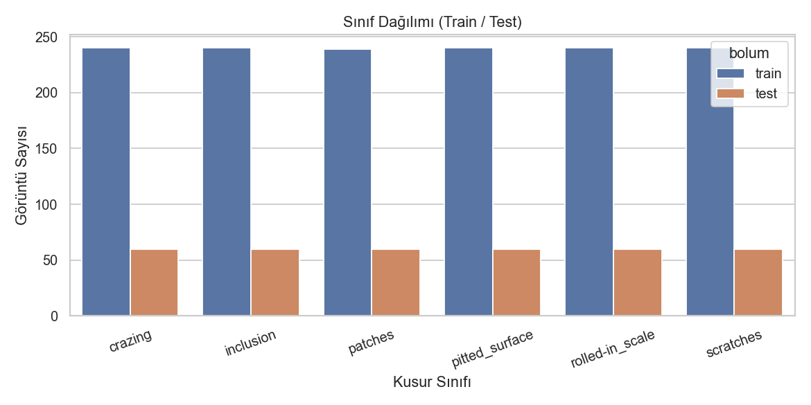
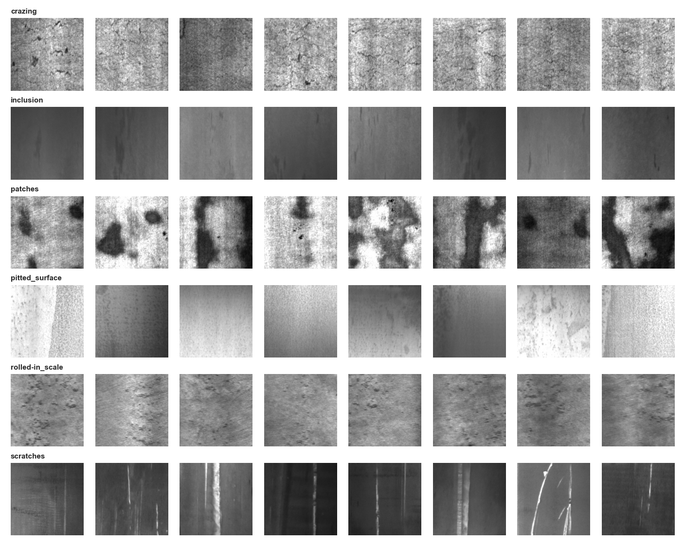
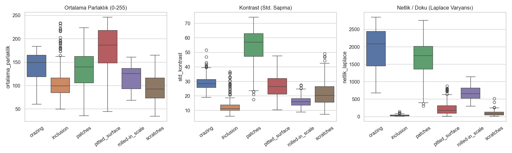
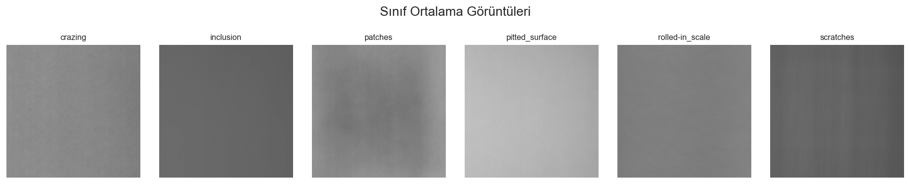
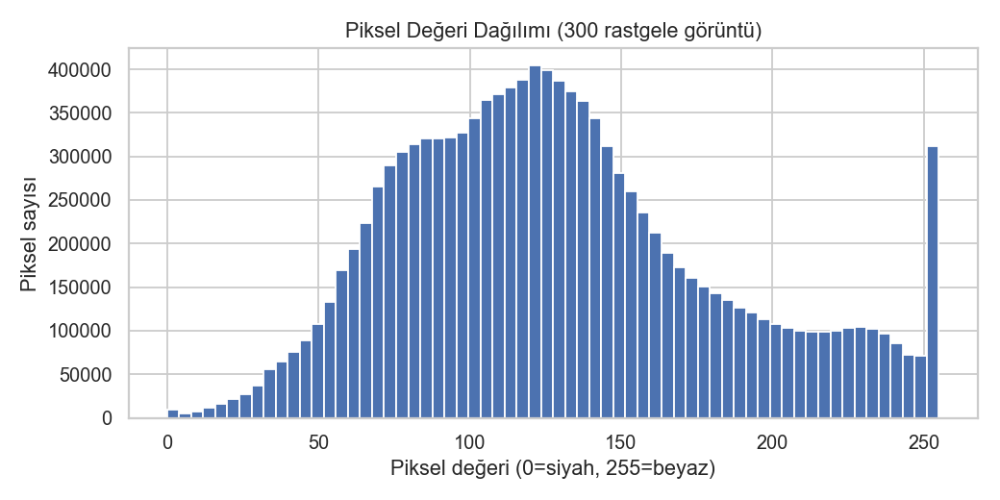

# 02 - Keşifçi Veri Analizi (EDA)

> İlgili kod: [`src/02_eda.py`](../src/02_eda.py)  
> Grafikler: `reports/figures/01..05_*.png`

**EDA'nın amacı:** Model kurmadan önce veriyi tanımak ve sonraki adımlardaki kararları (normalizasyon, augmentation, metrik seçimi) **kanıta** dayandırmak. Aşağıdaki her bulgunun sonunda "Bu bulgu hangi kararı etkiledi?" sorusunun cevabı vardır.

---

## 2.1 Sınıf dağılımı

| Sınıf | Train |
|---|---|
| crazing, inclusion, pitted_surface, rolled-in_scale, scratches | 240 |
| patches | 239 (1 kopya silindi) |

En büyük / en küçük sınıf oranı = **1.004** (1.0 mükemmel dengeli demektir).

**Karar:** Veri dengeli olduğu için `class_weight` gibi dengeleme yöntemlerine gerek yok ve **accuracy güvenle kullanılabilir**. (Dengesiz veride accuracy yanıltıcıdır; burada o risk yok. Yine de sınıf bazlı precision/recall'a bakacağız.)

---

## 2.2 Sınıflardan örnekler: gözle tanıma

Gözlemler (grafiğe bakarak):

- **crazing:** İnce, ağ benzeri çatlak dokusu; görüntünün tamamına yayılmış, yüksek frekanslı doku.
- **inclusion:** Genelde düz ve koyu bir zeminde küçük, uzamış koyu izler. Kusur görüntünün küçük bir kısmını kaplıyor; **ince ayrıntı** gerekiyor.
- **patches:** Büyük, yüksek kontrastlı koyu/açık lekeler; en kolay ayırt edilen sınıflardan biri.
- **pitted_surface:** Açık renkli zeminde küçük nokta çukurlar; parlaklık görüntüler arasında çok değişken.
- **rolled-in_scale:** Orta gri zeminde dağınık koyu benekler; `pitted_surface` ve `crazing` ile **görsel olarak karışma riski** taşıyor.
- **scratches:** Koyu zeminde parlak çizgiler (dikey ve yatay örnekler var).

**Karar:** Sınıf içi çeşitlilik yüksek (aynı sınıfta çok farklı parlaklık/zemin). Bu, **augmentation** (veri artırma) ve **kontrast/parlaklık dayanıklılığı** ihtiyacını gösteriyor.

---

## 2.3 Parlaklık, kontrast ve netlik: sınıflar istatistiksel olarak ayrışıyor mu?

Sınıf ortalamaları (`reports/eda_sinif_ozet.csv`):

| Sınıf | Ort. parlaklık | Kontrast (std) | Netlik (Laplace var.) |
|---|---|---|---|
| crazing | 141.1 | 29.1 | 1971.5 |
| inclusion | 106.4 | 13.0 | 36.3 |
| patches | 132.6 | 54.2 | 1631.6 |
| pitted_surface | 176.7 | 26.7 | 233.0 |
| rolled-in_scale | 117.9 | 16.1 | 673.2 |
| scratches | 95.2 | 21.7 | 94.5 |

Yorum:

- **Netlik (Laplace varyansı)** sınıfları en güçlü ayıran özellik: `crazing` ve `patches` ~2000 / ~1600 iken `inclusion` sadece ~36. Laplace varyansı kenar/doku miktarını ölçer: çatlak ağı çok kenar içerir, düz zeminli `inclusion` neredeyse hiç.
- **Ortalama parlaklık** sınıfları tek başına ayıramıyor: kutuların büyük kısmı üst üste biniyor (ör. `crazing`, `patches`, `rolled-in_scale` aralıkları kesişiyor).
- `inclusion` ve `pitted_surface` parlaklık dağılımında **uç değerler (aykırılar)** var; aynı sınıfta çok açık ve çok koyu görüntüler bulunuyor.

**Karar:** Basit istatistikler sınıfların **bir kısmını** ayırıyor ama hepsini değil. Bu yüzden 2.6'daki baz çizgi testini yaptık.

---

## 2.4 Sınıf ortalama görüntüleri

Her sınıftaki tüm eğitim görüntülerinin piksel ortalaması alındı.

- Çoğu sınıfta ortalama görüntü **neredeyse düz gri**: kusurlar görüntüde rastgele konumlarda, ortalamada kayboluyor.
- `scratches` ortalamasında **dikey şeritlenme** görülüyor (dikey çizikler baskın; yatay örnekler de var).
- `patches` ortalamasında merkeze doğru hafif koyulaşma var, yani lekeler biraz merkezde yoğun.

**Karar:** Kusurların konumu sabit değil → **kaydırma (translation) ve çevirme (flip) augmentation'ı güvenli**. Döndürmeyi temkinli bıraktık; çizik yönünün sınıf bilgisi taşıyıp taşımadığı kanıtlanmadı. (Bu, ileride denenebilecek bir deney.)

---

## 2.5 Piksel histogramı

300 rastgele görüntüde: ortalama **130.3**, standart sapma **53.7**, min **0**, max **255**.

- Dağılım tek tepeli, ~120 civarında.
- **255'te belirgin bir tepe (saturasyon):** Bazı görüntülerde pikseller tam beyaza doymuş (aşırı pozlama; özellikle açık renkli `pitted_surface`/`patches`). Doymuş bölgede ayrıntı kalıcı olarak kaybolmuştur.

**Karar:** Değerler 0-255 aralığında olduğundan `Rescaling(1/255)` ile **0-1'e normalize** ediyoruz (sinir ağları küçük, merkezlenmiş girdilerle daha kararlı öğrenir). Saturasyonu düzeltmek mümkün değil; veriyle yaşıyoruz ve bunu sınırlılıklar bölümüne not ediyoruz.

---

## 2.6 Baz çizgi (baseline): "Derin öğrenmeye gerçekten gerek var mı?"

Sektörde en sık atlanan adım: karmaşık modele geçmeden önce **çok basit bir yöntemin** ne kadar başardığına bakmak. Burada yalnızca 3 sayıyla (parlaklık, kontrast, netlik) bir Random Forest eğittik.

| Yöntem | Test doğruluğu |
|---|---|
| Rastgele tahmin | 0.167 |
| **3 basit istatistik + Random Forest** | **0.900** |

**Bulgu:** Yalnızca 3 sayı %90 doğruluk veriyor. Bu **güçlü bir baz çizgi**. CNN'in değer kattığını iddia edebilmesi için bu çıtayı **belirgin biçimde** geçmesi gerekir. Geçemezse "bu problem için derin öğrenme gereksiz" sonucuna varırız.

> Bu, mülakatlarda da güçlü bir cevaptır: *"CNN kurmadan önce basit bir baz çizgi koydum, çıta %90'dı; CNN'in katkısını buna göre ölçtüm."*

---

## 2.7 EDA özeti: bulgular → kararlar

| Bulgu | Karar |
|---|---|
| Sınıflar dengeli (oran 1.004) | `class_weight` yok; accuracy kullanılabilir |
| Sınıf içi çeşitlilik yüksek | Augmentation (flip, kaydırma, kontrast) |
| Kusur konumu rastgele | Kaydırma + çevirme güvenli |
| Piksel aralığı 0-255, 255'te saturasyon | `Rescaling(1/255)`; saturasyon veri sınırlılığı |
| 3 istatistikle %90 | CNN'in katkısı bu çıtaya göre ölçülecek |
| Tek kanal (gri) | Girdi şekli `(200, 200, 1)` |
